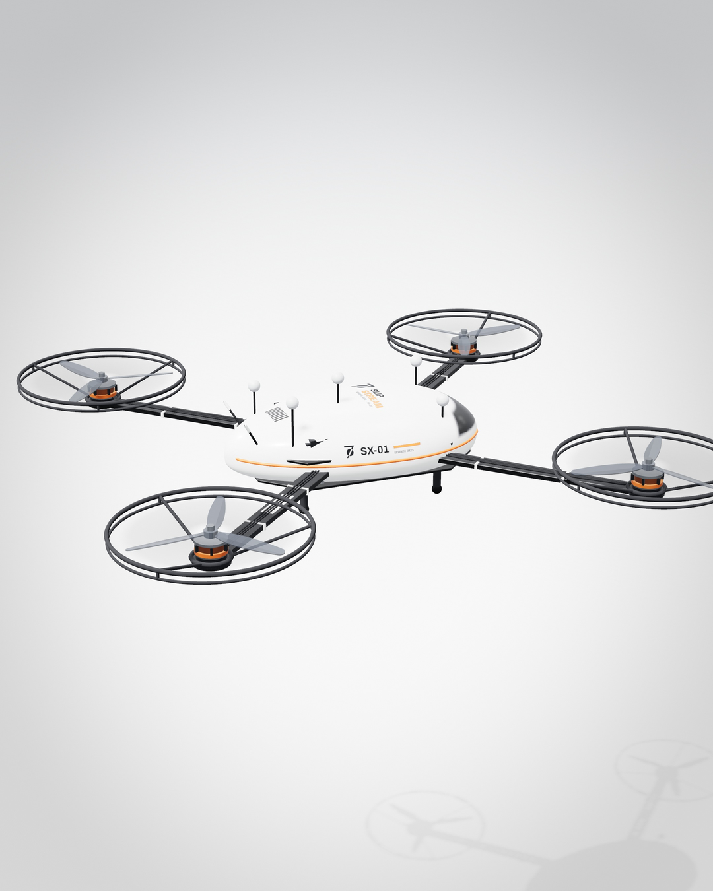

# SlipStream

**SX-01 morphing quadrotor · narrow-gap traversal · Seventh Axis Aerial Robotics**

SlipStream is a browser-based simulation of SX-01, a 1.25 kg research quadrotor whose arms fold on servos
so it can squeeze through gaps narrower than its own span, and roll knife-edge through slots narrower
than its folded width.



## What is in here

| Path | What it is |
|---|---|
| `slipstream.html` | The simulator: flight arena, SX-01 airframe, physics, autopilot, experiment console |
| `electronics/spice/` | ngspice models of the power chain: pack and bus, ESC bridge + BLDC, 12 V buck rail |
| `electronics/linkage/` | fold linkage synthesis: servo horn, pushrod and arm lever geometry, transmission angle, torque check |
| `electronics/harness/` | wiring harness parts list + netlist that builds the 3D harness and the wiring diagram (`harness.html`) |
| `blender/` | Cycles studio scene for photoreal stills, fed by the exported airframe |
| `electronics/notebook.html` | Engineering notebook: schematics, waveforms, SPICE vs. flight-model comparison |
| `electronics/build_notebook.py` | Fills the notebook from `spice/results.json` |
| `electronics/apply_feedback.py` | Copies SPICE-fitted constants into the simulator |
| `tools/render.py` | Headless renderer for videos and stills |
| `renders/` | Rendered videos (`videos/`) and stills (`stills/`) |

## Running the simulator

Serve the folder and open the page (fonts and three.js load from public CDNs):

```bash
python -m http.server 8000
```

Then open <http://localhost:8000/slipstream.html>.

- **Controller:** Autonomous cycles through the gates. Assisted and Manual take W A S D, Space/Shift, Q/E;
  F folds, V holds a knife-edge roll.
- **Gates:** A 1200 × 900 mm (open), B 520 × 1100 mm (fold), C 270 × 600 mm (fold + knife-edge).
- **Battery:** start a fresh pack at 100, 50 or 20 % charge; toggle battery-voltage compensation.
- **Chassis:** white shell, X-ray, or bare airframe.

## Flight and power model

- Rigid-body flight with cascaded position / attitude control and fold-aware gain scheduling.
- 4S 2200 mAh LiPo per cell: open-circuit voltage curve, ohmic + RC polarisation, coulomb counting, heating.
- Four ESCs with current limit, duty ramp and active braking, driving 1100 KV motors with a DC-equivalent
  model fitted from the SPICE switching simulation.
- 7.4 V servo, 12 V compute and 5 V flight-controller rails; the 12 V rail browns out on deep sag and the
  autopilot performs a failsafe landing.

## SPICE models

```bash
cd electronics/spice
python run_all.py            # needs ngspice on PATH or NGSPICE=...; the buck case takes several minutes
cd ..
python build_notebook.py     # writes notebook.html and feedback.json
python apply_feedback.py     # updates the constants in slipstream.html
```

## Renders

```bash
pip install playwright pillow   # uses the installed Microsoft Edge, no browser download
python tools/render.py videos   # renders/videos/*.mp4 (1080 × 1920)
python tools/render.py stills   # renders/stills/*.png (1080 × 1350)
```

Video encoding uses `ffmpeg` with libx264.
