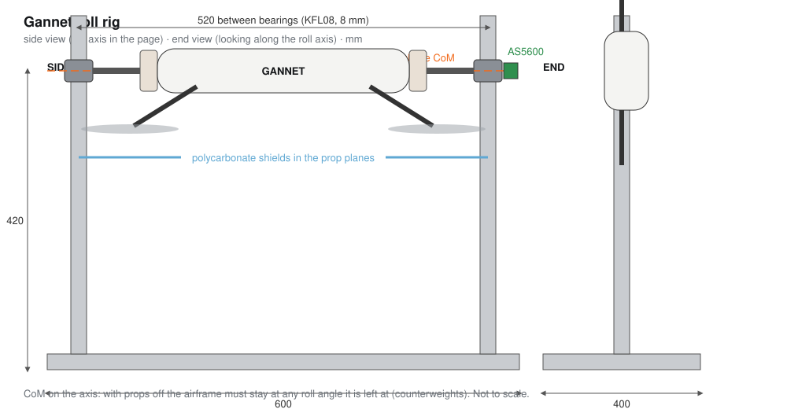

# Roll rig: the knife-edge's roll, stop and push-pull, tethered

Before Gannet flies a knife-edge, the three steps that only exist in this manoeuvre (roll-in with reversible
motors, all four rotors braked to a stop on its side, push-pull roll back) run on a rig that lets the airframe
turn about its long axis and nothing else. Same airframe, same ESCs, same `flight/knife_edge.lua`, with
`KNF_RIG = 1`. The simulator predicts every trace this rig records (`__SS.luaRig`, see `predicted.md`), so the
first rig run is also the first check of the simulator against hardware.

## Build (about 120 € in parts)

| Part | Qty | Note |
|---|---|---|
| 2020 aluminium extrusion, 600 mm | 2 | base rails |
| 2020 aluminium extrusion, 400 mm | 2 | base cross members |
| 2020 aluminium extrusion, 450 mm | 2 | uprights; roll axis 420 mm above the base |
| 2020 corner brackets + T-nuts, M5 | 12 | |
| Flanged pillow-block bearing KFL08 (8 mm bore) | 2 | one on top of each upright |
| 8 mm steel shaft, 120 mm | 2 | stub axles, nose and tail |
| Nose and tail adapters, printed PETG or PA-CF | 2 | clamp the carbon plate stack at the front and rear standoffs; each carries one stub axle on the roll axis |
| AS5600 magnetic encoder board + diametric magnet | 1 | on the tail stub: ground-truth roll angle at 1 kHz into the flight controller's I2C or a logger |
| Slip ring, 6 wire | 1 | optional: battery and telemetry through the axis instead of a loose lead |
| Brass counterweights, M5 threaded | 4 | bring the centre of mass onto the roll axis (gravity torque would hide the push-pull) |
| Polycarbonate sheet 3 mm, 600 × 450 mm | 2 | shields in both prop planes |
| End stops, printed, with 30 mm foam | 2 | limit roll to ±135° |

The roll axis must pass through the airframe's centre of mass: with the props off, it should stay at any roll angle
you leave it at. Adjust with the counterweights until it does.

## Tests, in order

Props **off** for 1 and 2, shields on for everything after. One person on the arming switch, nobody in the prop
planes. Log at the highest rate the flight controller allows (`LOG_BITMASK` with fast IMU), plus the encoder.

1. **Outputs and directions:** ArduPilot motor test at 1500 / 1550 / 1450 µs per motor: stopped, forward, reverse,
   and the prop turns the right way in each. Confirms `SERVO_BLH_3DMASK` and the AM32 3D setting.
2. **Script dry run:** `KNF_ENABLE 1`, `KNF_RIG 1`, armed in Stabilize, switch high. The GCS must show
   `KNF ROLL`, `KNF STOP`, `KNF PUSHPULL`, `KNF LEVEL`, `KNF DONE`, and the outputs follow the predicted PWM traces.
3. **Brake:** props on, hover throttle, then the switch with `KNF_RI_T1 = 0` and the roll-in disabled
   (`KNF_RI_WMAX = 0`): only STOP runs. Measure time to 0 rpm; compare with `rigs/thrust_stand`.
4. **Push-pull from 90°:** start held at 90° against the end stop, switch: STOP then PUSHPULL. Measure time to
   level and the overshoot.
5. **Full sequence:** from level, hover throttle, switch. Compare the encoder roll and the ESC rpm with
   `predicted.md`. A roll-in that overshoots on the rig will overshoot in the slot: tune here, not in the air.

## What to bring back

The flight log and the encoder log for tests 3-5. Feed the rotor timings to `tools/fit_thrust.py` (or the
thrust stand), rerun `python tools/flight_sitl.py`, and compare `__SS.luaRig()` with the rig traces until they agree.
